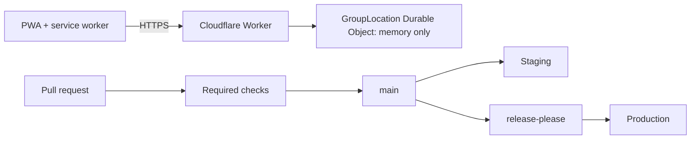

# Pushkara Mitra

An independent, Telugu-first, offline-capable pilgrim assistance PWA for the Godavari Pushkaralu 2027, built by Dream Team Engineers.

> **Independent app.** Pushkara Mitra is not an official application of, and is not endorsed by or affiliated with, any government, temple trust or event organiser. See [government-disclaimer](docs/legal/government-disclaimer.md).

> **Engineering readiness is not legal sign-off.** Passing CI means the code meets engineering gates. It says nothing about legal compliance. Legal status is tracked separately in [docs/compliance](docs/compliance/) and every item starts as `NEEDS REVIEW`.

**Status on `review/local-integration-snapshot-20261106`:** local review build with an original mobile-first PWA, a review-pending Plan screen, a Ghats screen showing 159 user-submitted names and localities as an explicitly unverified draft, offline static shell and disabled sensitive-service screens. The released `main` branch and approval state must be checked separately. This branch does not provide approved festival content, accounts, registration, emergency response, device location, payments or production services.

## Architecture and delivery



More in [docs/architecture.md](docs/architecture.md).

## Local setup

Requires Node 22 (see `.nvmrc`).

```bash
git clone https://github.com/Dream-Team-Engineers/pushkara-mitra.git
cd pushkara-mitra
npm ci
npm run check
npm run dev
```

`npm run check` runs lint, typecheck, tests and the format check. Secrets are never committed: copy `.dev.vars.example` to `.dev.vars` and fill it locally.

The [local integration runbook](docs/operations/local-integration.md) explains the review-pending app and test-only mock boundary. `npm run test:routing` exercises real local HTTP handling without deployment.

## Rules that matter

- **Location is never persisted or logged** ([ADR 0004](docs/decisions/0004-ephemeral-location.md)). A guard test enforces it.
- **GitHub settings change only through** `scripts/setup-github.sh`.
- Read [CONTRIBUTING.md](CONTRIBUTING.md) and [CLAUDE.md](CLAUDE.md) before your first PR.

## Registers and runbooks

| Area                    | Documents                                                                                                                                                                                                                                                                                                                                                                                                                                                                                                                                                                                                                      |
| ----------------------- | ------------------------------------------------------------------------------------------------------------------------------------------------------------------------------------------------------------------------------------------------------------------------------------------------------------------------------------------------------------------------------------------------------------------------------------------------------------------------------------------------------------------------------------------------------------------------------------------------------------------------------ |
| Standards and decisions | [Engineering standards](docs/ENGINEERING_STANDARDS.md) (placeholder), [ADRs](docs/decisions/), [open questions](docs/decisions/OPEN_QUESTIONS.md)                                                                                                                                                                                                                                                                                                                                                                                                                                                                              |
| Security                | [Threat model](docs/security/threat-model.md), [architecture](docs/security/security-architecture.md), [incident response](docs/security/incident-response.md), [vulnerability management](docs/security/vulnerability-management.md), [test evidence](docs/security/security-test-evidence.md)                                                                                                                                                                                                                                                                                                                                |
| Compliance              | [Legal register](docs/compliance/legal-register.md), [DPDP](docs/compliance/dpdp-checklist.md), [DPIA](docs/compliance/dpia.md), [data inventory](docs/compliance/data-inventory.md), [consent](docs/compliance/consent-register.md), [CERT-In](docs/compliance/cert-in-checklist.md), [payments](docs/compliance/payments-compliance.md), [donations](docs/compliance/donations-legal.md), [e-commerce](docs/compliance/ecommerce-compliance.md), [children](docs/compliance/children-data-safety.md), [accessibility](docs/compliance/accessibility-compliance.md), [evidence index](docs/compliance/compliance-evidence.md) |
| Legal and IP            | [Copyright policy](docs/legal/copyright-policy.md), [licence register](docs/legal/licence-register.md), [attributions](docs/legal/third-party-attributions.md), [trademark](docs/legal/trademark-review.md), [asset permissions](docs/legal/asset-permissions.md), [disclaimer](docs/legal/government-disclaimer.md)                                                                                                                                                                                                                                                                                                           |
| Operations              | [Runbook](docs/operations/runbook.md), [breach response](docs/operations/breach-response.md), [post-event deletion](docs/operations/post-event-deletion.md), [disaster recovery](docs/operations/disaster-recovery.md), [release readiness](docs/operations/release-readiness.md)                                                                                                                                                                                                                                                                                                                                              |
| Other                   | [i18n](docs/i18n.md), [performance budget](docs/performance-budget.md)                                                                                                                                                                                                                                                                                                                                                                                                                                                                                                                                                         |

## Licence

All rights reserved for now. The licence choice is an open question (OQ-008).
