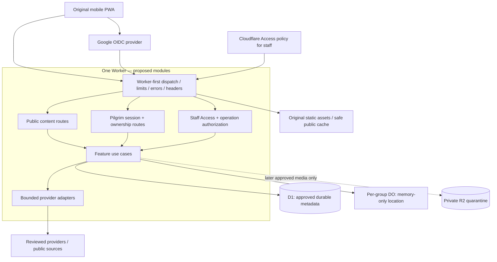
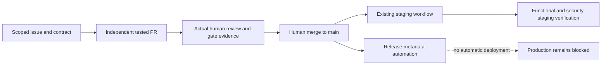

# Pushkara Mitra — recommended application architecture

**Decision status:** concrete engineering recommendation for review, not implemented architecture or G0/G1 approval. Audit base: main `cc26ee271e7b961bcd90900c0e8a043774cde406`, 2026-11-04 (IST). No application files or bindings are changed by this document.

Read [original product blueprint](proposals/PRODUCT_BLUEPRINT.md), [delivery readiness audit](DELIVERY_READINESS.md), [backend decision contracts](proposals/BACKEND_FOUNDATION_DECISIONS.md) and [standards adoption checklist](proposals/STANDARDS_ADOPTION_CHECKLIST.md).

## 1. Recommendation and current reality

Use **one modular Cloudflare Worker and one mobile-first PWA**, with a shared, browser-safe contract layer. Keep one repository and deployment unit initially. Do not introduce microservices, a second database, a generic event bus or a monorepo migration before measurements justify them. Isolate business features in code so they can later be extracted without moving authorization into the browser.

Current code is much smaller: a static placeholder, `/healthz`, response-header middleware, disabled flags, a Durable Object returning 501 and an empty migration. D1, R2, sessions, application APIs, original mobile UI and offline behavior are absent. The target below is a plan, not an inventory of delivered features.

**First remediation:** [issue #38](https://github.com/Dream-Team-Engineers/pushkara-mitra/issues/38). Local QA proved assets-first routing bypasses Worker response headers. A separate local experiment with `assets.run_worker_first = true` restored the intended behavior across ten local HTTP request cases without ASSETS recursion. This is not yet a main or deployed fix. Verify every environment's asset table and real Wrangler delivery in the implementation PR. Future API/auth/staff boundaries must run before asset fallback, not depend on frontend route guards.

## 2. Trust boundaries



Public information is available without login. Protected pilgrim actions use the proposed server-verified Google identity/session contract. Staff authentication uses a **separate Access verifier** plus server-owned permissions. A public identity, email string, client role or verification badge never confers staff access. Provider configuration, role/retention/session contracts and actual G1 decisions must precede real processing.

### Route ownership

| Namespace                                    | Boundary                                              | Required behavior                                                                                                 |
| -------------------------------------------- | ----------------------------------------------------- | ----------------------------------------------------------------------------------------------------------------- |
| `/healthz`                                   | Public operational endpoint                           | Minimal health response; no dependency credentials, internal topology or personal data                            |
| Public app pages and versioned static assets | Public presentation                                   | Original content/assets, correct headers; only reviewed public assets cacheable                                   |
| `/api/v1/content/*`                          | Public read API                                       | Published DTOs only; pagination, source/freshness metadata and explicit public-cache policy                       |
| `/auth/*`                                    | Provider/session protocol                             | Exact callback/return allow-lists, state/nonce/PKCE as selected, replay and error controls; never static fallback |
| `/api/v1/me/*`                               | Verified pilgrim session                              | Server-derived subject, ownership on reads/lists/writes, CSRF for cookie mutations, `no-store`                    |
| `/admin` and `/admin/*`                      | Staff UI entry                                        | Access policy and Worker verification before HTML/assets/fallback; do not rely on hidden menus                    |
| `/api/v1/staff/*`                            | Staff API                                             | Verified Access principal plus explicit operation/resource permissions; `no-store` and minimal audit              |
| Group connection/update endpoints            | Approved group capability + identity/consent contract | Membership at connect and each operation, bounded session, no coordinate persistence                              |
| Unknown API/auth/staff paths                 | Reserved namespaces                                   | Stable JSON 404/405/401/403 as appropriate; never return public SPA HTML as accidental success                    |

Test exact paths, nested paths, encodings/normalization, unsupported methods and asset filename collisions against actual Wrangler routing. Validate external redirect targets and provider origins from a fixed configuration, not a request-controlled URL.

## 3. Target file structure

This is the recommended **incremental target**, not a request to create empty directories or move everything now. Existing `src/index.ts`, headers, migrations and tests remain source-of-truth until a reviewed migration is implemented. Introduce separate browser/server TypeScript configurations in the frontend-build PR; browser DOM types and Worker bindings must not leak across projects.

```text
web/                              # original browser application; proposed
  index.html
  app/
    bootstrap.ts                  # startup, session-state hydration, app errors
    router.ts                     # route rendering; not authorization
    shell/                        # original header/navigation/offline/status UI
  features/
    my-pushkaram/                 # home, preferences, profile/inbox presentation
    visit-planner/                # schedule, map, stays, transport, culture
    pilgrim-pass/                 # owned registration and approved QR display
    travel-together/              # group UI; no persisted coordinates
    help-reunite/                 # safe help and moderated report flows
    festival-updates/             # news, advisories, contextual assistance
    community-partners/           # disclosed listings/inquiry, not checkout
  staff/                          # code-split staff entry and operations UI
  components/                     # original accessible UI primitives
  services/api-client.ts          # typed DTO requests; no secrets or SQL
  i18n/                           # independently authored te/en/hi/mr catalogs
  styles/                         # independently designed tokens and layouts
  pwa/                            # registration/update UI and safe cache manifest
shared/
  contracts/
    common.ts                     # public errors, pagination and stable IDs
    content.ts                    # public request/response schemas
    identity.ts                   # safe principal/session DTOs, never raw tokens
    consent.ts                    # approved purpose/version action contracts
    features/                     # validated feature-specific DTOs
src/
  index.ts                        # Worker exports and composition only
  env.ts                          # server-only binding types and config validation
  http/
    router.ts                     # reserved/public/user/staff dispatch
    context.ts                    # verified request context, not raw token export
    middleware/                   # request ID, body caps, safe errors, headers
  auth/
    google.ts                     # selected OIDC flow and trusted verification
    access.ts                     # independent staff issuer/JWKS/audience verifier
    principals.ts                 # trusted stable subject mapping
    sessions.ts                   # approved expiry, rotation and revocation
    authorize.ts                  # deny-by-default operation/resource policy
    csrf.ts                       # cookie-authenticated mutation protection
  security/
    headers.ts                    # existing header policy, tested on real assets
    rate-limit.ts                 # reviewed consistent counter adapter
    input-policy.ts               # bounded shapes/lengths/content types
  features/
    content/                      # routes.ts, service.ts, repository.ts
    pilgrims/                     # approved ownership/minimal identity records
    consent/                      # grant/withdrawal and enforcement
    staff/                        # publishing/moderation use cases and permissions
    audit/                        # approved minimal event taxonomy
    groups/                       # approved membership/control, never location SQL
    reports/                      # approved moderation/contact-redaction flows
  data/d1/                        # binding adapter, prepared SQL, transactions
  durable-objects/
    GroupLocation.ts              # existing stub; later per-group ephemeral state
  integrations/                   # timeout/quota-bound provider adapters
  privacy/                        # redaction, classification and deletion orchestration
  observability/                  # scrubbed metrics/events; no request-body logs
  flags.ts                        # fail-closed flags; do not enable gated features
migrations/                       # reviewed durable non-location schemas only
public/                           # original static/icon assets; provenance recorded
scripts/                          # build/check/generation tools; no secret values
  build-public-content.mjs         # proposed reviewed snapshot build, if adopted
  verify-boundaries.mjs            # proposed import/bundle/persistence checks
  smoke-staging.mjs               # proposed functional smoke; never deploy
  check-budgets.mjs               # proposed measured bundle/response limits
  setup-github.sh                 # existing exclusive settings-change path
config/                           # proposed validated non-secret environment schemas
  content-sources/                 # reviewed provenance/freshness, not invented facts
  consent-purposes/                # human-approved notice/version registry
  feature-policy/                  # gated-feature prerequisites and defaults
tests/
  worker/                         # existing + real route/auth/ownership cases
  guards/                         # existing privacy/release/config safeguards
  contracts/                      # DTO/schema/error compatibility
  integration/                    # real Wrangler assets, local D1 and DO lifecycle
  browser/                        # original mobile/desktop flows and screenshots
  offline/                        # static allow-list, update/stale/private-cache tests
  accessibility/                  # keyboard, axe, zoom, language/manual review
  load/                           # synthetic request/fan-out/latency profiles
  fixtures/                       # synthetic only; no real personal data/credentials
docs/                             # architecture, original product and decision evidence
wrangler.toml                     # reviewed environment bindings and routing policy
package.json / package-lock.json  # scripts, reviewed dependencies, frozen install
.nvmrc                            # existing pinned runtime major; compatibility reviewed
tsconfig.json                     # existing server config until migration is tested
tsconfig.worker.json              # proposed Worker-only types/boundaries
tsconfig.web.json                 # proposed browser DOM types; no server bindings
tsconfig.contracts.json           # proposed environment-neutral contract checks
vite.config.ts                    # proposed original client build and split bundles
vitest.config.ts                  # existing Worker/guard projects; extend deliberately
playwright.config.ts              # proposed real-browser/mobile/offline test matrix
.github/CODEOWNERS                # named reviewers; not automatic review enforcement
.github/workflows/                # quality/security gates; production stays blocked
PROJECT_STATUS.md                 # newest-first IST task accountability
```

A small TypeScript/Vite client is the initial build recommendation; Vite is already a development dependency, but there is no frontend build today. A component framework remains a documented maintenance/dependency decision, not a reason to port the reference's code or UI library. Add only reviewed dependencies with licence and bundle-budget evidence. Build output is ignored `dist/client`; switching Wrangler's asset directory must happen in the same tested build migration, not leave main pointing to missing files.

### Dependency rules to enforce in CI

- Browser code imports `web` and browser-safe `shared/contracts` only. It cannot import `src`, bindings, SQL, provider secrets or server logs. Build-artifact inspection must verify no credential/config leakage.
- Shared contracts contain schemas/DTOs, not database rows, provider claims, privileged repositories or environment reads. DTOs are intentionally smaller than storage models.
- Routes validate input and authenticate/authorize before use cases. Services use verified context and feature-owned repositories; they do not trust a client-supplied subject or role.
- SQL and transactions stay behind repositories, with prepared statements and ownership in query predicates. No generic arbitrary-query HTTP endpoint or generic JSON metadata dumping ground.
- Feature cross-calls go through explicit services/contracts, not another feature's private tables. Shared middleware stays business-neutral.
- Encode these rules with restricted imports/boundary tests, not documentation alone. Current lint does **not** yet implement these architectural checks.

## 4. Identity, authorization and private data

Use trusted issuer/subject mapping and per-operation permissions. Google OIDC verification checks signature, approved algorithms, issuer, audience and time claims; state/nonce and PKCE/replay controls follow the selected flow. Pin allowed issuers/key endpoints, bound key fetch/cache size and handle rotation without fail-open. Do not send service secrets or raw provider credentials to the client bundle.

For cookie sessions, the recommended starting contract is opaque unpredictable session tokens in Secure/HttpOnly host-scoped cookies, a server-side protected representation, session rotation and revocation, and SameSite plus explicit CSRF controls for mutations. Exact lifetimes, storage, recovery and concurrent-session policy require the recorded identity/privacy contract; this document invents none. Do not request offline provider access or store refresh tokens by default.

Staff Access verification is separate and also checks trusted issuer/audience/signature/time. Assignment and emergency revocation are human-owned; no first-user admin, email-match promotion or self-enrolment. API role checks and ownership also apply to lists, bulk operations, indirect IDs and media URLs.

Private/auth/session/consent/staff responses use `Cache-Control: no-store`; CDN and service worker both exclude them. Clear private in-memory state on sign-out. No auth token, identity document, personal QR/card or location in localStorage, IndexedDB, Cache Storage, telemetry or a generic offline queue. Public preferences may use reviewed local-only storage; that does not authorize storing personal records.

Use a restrictive CSP designed for the original build: self-host scripts/styles/fonts where feasible, no blanket `unsafe-inline`/`unsafe-eval`, and only reviewed map/provider destinations. The current `default-src 'none'` policy is not a ready application policy; change it only with browser/provider compatibility and negative tests. Same-origin APIs are the default; no credentialed wildcard CORS. Cross-site mutations need the reviewed Origin/CSRF rules, not SameSite alone. OIDC redirect/popup behavior must be tested against COOP/CSP before weakening isolation.

Validate both request and response schemas. Use a stable safe error envelope with a server-generated bounded request identifier; never raw stack traces, SQL/provider errors or user-supplied log fields. Secrets/JWTs do not appear in query strings, analytics or exception attachments. Enforce these on errors, redirects and static responses as well as successful API calls.

## 5. Persistence and consistency

| Data class                                                             | Candidate storage                                    | Boundary                                                                                                 |
| ---------------------------------------------------------------------- | ---------------------------------------------------- | -------------------------------------------------------------------------------------------------------- |
| Versioned public assets / reviewed public content snapshots            | Static asset/CDN cache                               | Explicit public allow-list, source/version/freshness; no personal fields                                 |
| Approved minimal accounts, ownership, consent, audit, moderation state | D1                                                   | G1 schema/retention review; indexed subject-scoped queries, transactions/idempotency, bounded pagination |
| Personal group coordinates and live updates                            | Per-group Durable Object memory only                 | No D1/KV/R2/DO storage, alarms for recovery, hibernation attachments, logs or retained history           |
| Approved photos/documents                                              | Private R2 quarantine only after applicable approval | No current binding; media feature is not enabled by architecture                                         |
| Secrets                                                                | Approved environment secret bindings                 | No source/client bundle/storage/log exposure                                                             |

Avoid an unbounded D1 query per map movement or every fan-out message. Use authoritative reads for sessions, revoked roles and withdrawn consent until an explicit tested consistency/revocation contract permits caching. A stale read replica must not resurrect authorization or consent. Public content can use immutable snapshots/ETags and measured bounded queries. D1 replicas/sharding are later measured options, not promised unlimited capacity.

Audit append-only application behavior is not tamper-proof administrative storage. Specify the outcome of sensitive operations if mandatory audit writes fail. Approved retention/erasure and backup/Time Travel restore behavior need a privileged reviewed procedure; a blanket permanent no-delete claim is not a lawful retention policy. Source records may reference public facility coordinates only after explicit classification and a narrow reviewed persistence exception; this never permits personal location history.

## 6. Abuse, media and integrations

Apply body/content-type limits before parsing; bounded strings/arrays, stable safe errors, pagination, idempotency and outbound timeouts. Select a consistent abuse-counter mechanism after confirming platform/plan support; per-isolate memory alone cannot provide a global limit. If a mandatory protection is unavailable, reject the protected operation honestly rather than silently disabling it. Hashing IPs does not automatically make abuse records non-personal; classification/retention still apply.

Approved media flows need size/type limits, random object keys, private quarantine, metadata/EXIF removal, scanning/moderation, scoped short-lived access, owner checks and deletion tests. Remove/reject location-bearing metadata on a trusted bounded path **before any durable write, including quarantine**; browser-only stripping is insufficient. If safe server-side sanitization is unavailable, reject the upload rather than temporarily persist raw geotagged media. No public bucket, path-controlled fetch, arbitrary URL import or bypass for child/missing-person data. Do not implement media collection before these operations and approvals exist.

Adapters for weather, maps, verified public sources or assistance have allow-listed destinations, cancellation/timeouts, bounded retries, quotas/circuit breakers and safe unavailable/stale UI. No unapproved spending or hidden fallback to the benchmark's external backend. Crowd data needs source/time/confidence; heuristic estimates are not verified live counts. SOS must not promise dispatched rescue without a real acknowledged operator protocol.

## 7. Scale, availability and observability

Start with CDN-served immutable original assets and reviewed public snapshots, then measure the dynamic paths. Keep auth state authoritative and dynamic DTOs bounded. Lazy-load maps and less-used routes; subset licensed fonts; enforce the proposed budgets in [performance-budget.md](performance-budget.md) before claiming them met.

One DO per bounded group/session isolates fan-out; never one global festival object. Define participant/message/frame/lifetime limits through load tests and reviewed threat models. Eviction/restart loses memory by design; clients show unavailable/stale state and re-establish approved sharing. Do not reintroduce persistence to conceal the limitation. Background location is not promised by a PWA or wrapper. Integration tests must preserve WebSocket upgrade/101 responses through header/error middleware; naive response cloning must not break approved group connections. Exported QR/cards must never become reusable authentication credentials or unrestricted personal-data bearers.

Use synthetic traffic for public cache misses, login bursts, D1 writes/lock contention, revocation/withdrawal, bounded group fan-out and provider outage. Record p50/p95/p99, error rates, rate-limit behavior, CPU/subrequests/storage usage and quota headroom. Load-test volume and paid resources require explicit authorization; no event-scale capacity number is currently supported by evidence.

Scrubbed metrics and structured events exclude request bodies, query tokens, coordinates and identifiers not approved for operational use. Review infrastructure/provider logs as well as app logs. Define alert owners, incident escalation, RTO/RPO, recovery/restore drills, expiry and failure behavior before launch. Health alone is not feature readiness.

## 8. Delivery and incremental migration



No agent merges, deploys production, changes paid settings or replaces human approval. Corrected standards adoption and feature-specific G0–G4 decisions remain explicit. CI passing does not certify legal compliance.

Recommended sequence:

1. Worker-first/header boundary and real-routing integration tests (issue #38); independently review stabilization PRs #34–36.
2. Approve the concrete standards/scope disposition and frontend build contract. Introduce `web`, browser/server TS boundaries, original shell/tokens/navigation, safe PWA registration/icons/offline fallback and one public content contract. Do not reorganize every folder before this slice works.
3. In parallel, finish identity/roles/session/data/retention/provider decisions; then implement auth and ownership with negative tests, followed by minimal approved D1 consent/audit foundations.
4. Add the complete original product journeys in dependency order using shared contracts and independent feature PRs. Sensitive activation waits for specific safety/privacy/operational approvals.
5. Verify browser/mobile/offline/accessibility, real staging feature flows, load/abuse, restore and operational ownership. Decide native packaging separately if stores/device APIs are required.

Use the smallest migration PR that makes each step concrete, preserve lockfiles/version history and keep status entries newest-first with IST time and named implementer/owner/reviewer/evidence.
