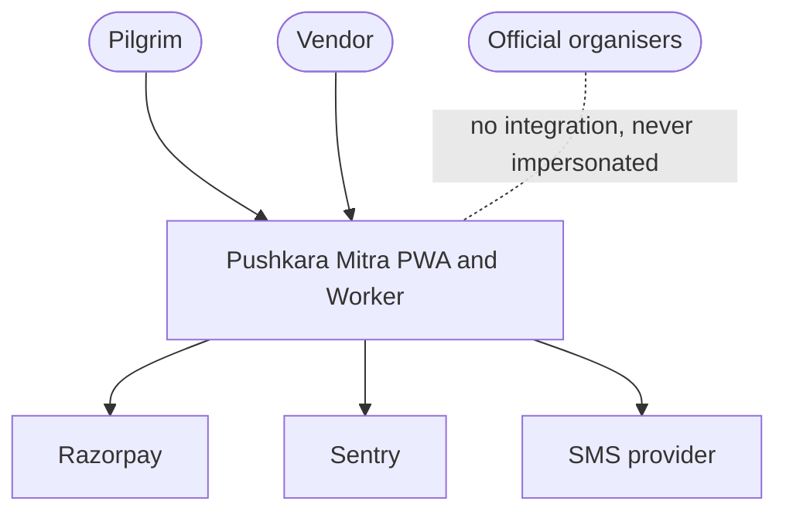
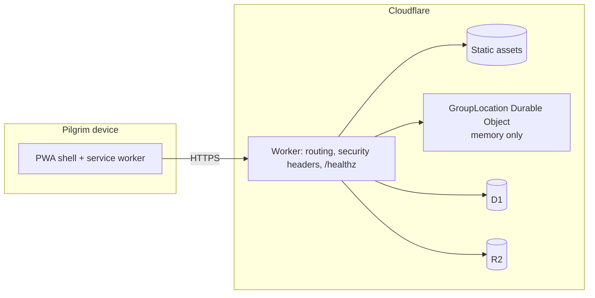
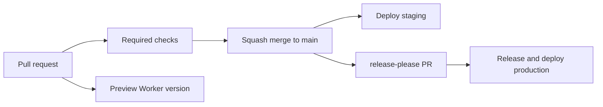

# Architecture

Pushkara Mitra is an independent, Telugu-first, offline-capable PWA served from Cloudflare Workers. It is not an official application.

## C4 level 1: context

## C4 level 2: containers

Today only the Worker, static assets and a stub Durable Object exist. D1 and R2 are not bound yet.

## Delivery

## Key decisions

[ADR 0002](decisions/0002-trunk-based-delivery.md), [0003](decisions/0003-offline-first-pwa.md), [0004](decisions/0004-ephemeral-location.md), [0005](decisions/0005-log-residency-and-minimisation.md).
