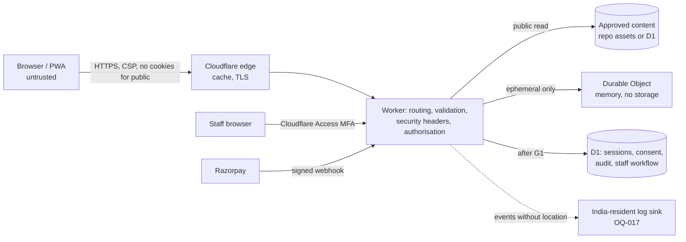

# 0012. Backend architecture and D1 verdict — decision proposal

Status: **PROPOSED — not accepted. No approval is recorded.** Prepared 2026-11-11 (IST) against `main` at `f0ac908`. This proposal creates no binding, database, route, migration or processing purpose. Engineering analysis only; legal and privacy conclusions stay with counsel (none appointed yet, OQ-016, OQ-024).

Related: [ADR 0003](0003-offline-first-pwa.md), [0004](0004-ephemeral-location.md), [0005](0005-log-residency-and-minimisation.md), [0006](0006-children-and-dependents.md), [0008](0008-user-authentication.md), [0010](0010-error-tracking.md), [0011](0011-frontend-stack-and-hosting.md), [foundation approval record](FOUNDATION_APPROVAL_RECORD.md), [BF decisions](../proposals/BACKEND_FOUNDATION_DECISIONS.md), [contract acceptance](../proposals/BACKEND_CONTRACT_ACCEPTANCE.md), [data model proposal](../proposals/DATA_MODEL_PROPOSAL.md).

## 1. Recommendation in one paragraph

Keep the existing **Cloudflare Worker (TypeScript, strict) as the only backend service**, with Durable Objects for ephemeral group coordination and **D1 only for small, structured, non-location data** once G1 contracts are approved. Do not add a separate backend service now. **D1 is acceptable for public content, staff workflow, sessions, consent and audit records at the planned scale, but it is not yet acceptable as the system of record for personal data** until the data-residency question (section 5) is answered by counsel and the owners, because D1 offers no India location guarantee. **Workers Free is suitable for development and preview only; it cannot carry festival traffic** (section 6).

## 2. Requirements that drive the choice

| Requirement                                                                                    | Source                                   |
| ---------------------------------------------------------------------------------------------- | ---------------------------------------- |
| Location never persisted or logged; ephemeral group state                                      | ADR 0004, CLAUDE.md rule 1               |
| Public content readable offline and during congestion; low bandwidth                           | ADR 0003, master instructions section 11 |
| Server-side authorisation on every protected operation, deny by default                        | master instructions section 4, BF-03     |
| Staff behind Cloudflare Access with MFA; pilgrims mostly anonymous                             | ADR 0008 candidate; owner answer 11 Nov  |
| Minimal personal data, deletion after the event, restores reconciled                           | master instructions section 5, BF-08     |
| Logs free of coordinates/secrets; India-resident sink if CERT-In applies                       | ADR 0005, 0010, OQ-007, OQ-017           |
| Team of three; low operational burden; prefer free/low-cost; never weaken privacy to save cost | master instructions sections 1, 3        |
| Peak load around 26 Jun to 7 Jul 2027 (provisional, OQ-004)                                    | master instructions                      |

## 3. Options compared

| Option                                                                   | Residency control                                            | Operations effort (3 people)                               | Security surface                                                   | Cost                           | Peak load                                     | Migration risk                   |
| ------------------------------------------------------------------------ | ------------------------------------------------------------ | ---------------------------------------------------------- | ------------------------------------------------------------------ | ------------------------------ | --------------------------------------------- | -------------------------------- |
| **A. Existing Worker + DO + D1 (recommended)**                           | Weak for D1/DO (no India guarantee, section 5)               | Lowest: no servers, one deploy path, exists                | Small; no network-reachable database; Access for staff             | Usage-based; Free for dev only | Edge scale; D1 write path is single-primary   | None (already in place)          |
| B. Worker + external managed Postgres in an Indian region via Hyperdrive | Stronger, if the provider region is verified and contractual | Medium: patching/backups/failover, a second vendor and DPA | Larger: database network exposure, credentials, connection pooling | Higher fixed cost              | Postgres write scale; extra latency per query | Medium: schema and driver change |
| C. Separate Node/Go service on an Indian cloud, Cloudflare as edge only  | Strongest control for stored data                            | Highest: servers, scaling, on-call, hardening              | Largest                                                            | Highest fixed cost             | Must size and autoscale ourselves             | High                             |
| D. Workers + KV only                                                     | Same weakness as A                                           | Low                                                        | Eventual consistency, no transactions, poor for consent/audit      | Low                            | High reads                                    | Not suitable for consent/audit   |

**Why A now:** every requirement except India residency is met with the least moving parts, and the team is three people. **Re-open B or C if** the residency decision (section 5) requires India-located storage that D1/DO cannot provide. Provider names for B/C are deliberately not chosen here; no provider region or term has been verified.

## 4. Cloudflare facts used (official documentation, retrieved 2026-11-11 IST)

Limits and prices change. Re-verify before any decision depends on them.

| Fact                                                                                                                                                                                                                      | Source                                                                                                                        |
| ------------------------------------------------------------------------------------------------------------------------------------------------------------------------------------------------------------------------- | ----------------------------------------------------------------------------------------------------------------------------- |
| D1 max database size 500 MB (Free), 10 GB (Paid); 10 databases (Free); queries per invocation 50 (Free), 1000 (Paid); max row/string 2 MB; 100 bound parameters                                                           | https://developers.cloudflare.com/d1/platform/limits/                                                                         |
| D1 Free: 5 million rows read/day, 100,000 rows written/day, 5 GB storage; Paid includes 25 billion reads and 50 million writes per month; index writes count as rows written                                              | https://developers.cloudflare.com/d1/platform/pricing/                                                                        |
| D1 location hints: wnam, enam, weur, eeur, apac, oc. **No India hint.** Hints are not guarantees. Jurisdictions: eu, fedramp, us only; set at creation only                                                               | https://developers.cloudflare.com/d1/configuration/data-location/                                                             |
| D1 Time Travel is always on, cannot be disabled, restores in place; retention 7 days (Free), 30 days (Paid)                                                                                                               | https://developers.cloudflare.com/d1/reference/time-travel/                                                                   |
| Workers Free: 100,000 requests/day, 10 ms CPU per request, 50 subrequests; Paid has no request limit and CPU up to 5 min                                                                                                  | https://developers.cloudflare.com/workers/platform/limits/                                                                    |
| Static asset requests are free and unlimited, **but with `run_worker_first` they are billed as Worker requests**; over the Free limit they get 429                                                                        | https://developers.cloudflare.com/workers/static-assets/billing-and-limitations/                                              |
| Durable Objects on Free: SQLite backend only; 100,000 requests/day; incoming WebSocket messages bill at 20:1                                                                                                              | https://developers.cloudflare.com/durable-objects/platform/pricing/                                                           |
| Access JWT: validate `Cf-Access-Jwt-Assertion`; check `aud` and `iss` (`https://<team>.cloudflareaccess.com`); fetch keys from `/cdn-cgi/access/certs`; match `kid`; keys rotate about every 6 weeks with a 7-day overlap | https://developers.cloudflare.com/cloudflare-one/access-controls/applications/http-apps/authorization-cookie/validating-json/ |

Not retrieved, so not relied on: the Workers Paid base price, D1 single-database write throughput figures, and the Rate Limiting binding's limits. Each must be read from official pages before use.

## 5. D1 verdict and data residency

| Workload                                                      | D1 fit                                                                                            |
| ------------------------------------------------------------- | ------------------------------------------------------------------------------------------------- |
| Public content (ghats, stays, travel, updates, versions)      | **Good.** Small, read-heavy, non-personal. Put an edge cache in front so D1 sees few reads.       |
| Staff workflow, role assignment, audit                        | **Good** at this volume. Staff identifiers are personal data; residency question applies.         |
| Sessions, consent ledger                                      | **Acceptable** once BF-01/04/05/07/08 are approved; small row counts; residency question applies. |
| Pass records, group metadata, partner inquiries, payment refs | **Conditional** on BF decisions and counsel; residency question applies.                          |
| **Live location**                                             | **Never.** Durable Object memory only (ADR 0004). No D1, DO storage, telemetry or error reports.  |
| Missing-person reports, child data                            | **Blocked** (ADR 0006, dedicated review). No table is proposed.                                   |

**Residency.** D1 cannot be pinned to India: there is no India hint, an `apac` hint is not a guarantee, and the only jurisdictions are `eu`, `fedramp` and `us`. My reading of the DPDP Rules, from a secondary source and not the Gazette, is that cross-border processing is broadly permitted unless the Central Government restricts it, with possible localisation for Significant Data Fiduciaries; CERT-In log-location duties are unverified (OQ-007). **Counsel must say whether storing the personal-data tables outside India is acceptable.** Until then: no personal-data table is created, and the design minimises what could ever be stored (opaque subject reference, no phone/email in our database where an identity provider can hold them).

**Time Travel vs deletion.** Restores are in place and cannot be disabled, so a row deleted today can reappear after a restore within 7 days (Free) or 30 days (Paid), and backups are outside our deletion job. Proposed mitigations for review (BF-08): (a) encrypt personal fields with a per-subject or per-cohort key held outside D1 and destroy the key on erasure ("crypto-shredding"), so a restored row is unreadable; (b) after any restore, re-run deletion and withdrawal jobs from an append-only erasure list; (c) disclose the backup window in the notice. None is approved.

**Authority requests and legal hold.** Design for a documented process, not ad-hoc exports: a named nodal officer (not yet appointed, OQ-023), written verification of the legal basis, a request register, an admin-only export that needs dual approval and MFA and is audit-logged, and a legal hold that suspends deletion for named records. Because location is never stored, it cannot be produced; counsel must confirm that statement and any interception or technical-assistance duty. No statute section is cited here because none has been verified.

## 6. Capacity model (every traffic figure is an ASSUMPTION; no load test has been run)

No official attendance forecast has been obtained (OQ-025). Two planning scenarios only:

| Assumption                                | S1 (low) | S2 (high) | Basis                                                             |
| ----------------------------------------- | -------- | --------- | ----------------------------------------------------------------- |
| Daily active users on the busiest day     | 100,000  | 1,000,000 | Placeholder to show order of magnitude, not a forecast            |
| API reads per user per day (screen opens) | 20       | 20        | Frontend uses stale-while-revalidate, 6 to 24 h stale thresholds  |
| First-visit asset requests per new user   | 25       | 25        | Built app has about 25 files; later visits use the service worker |
| Peak-hour factor over the daily average   | 10x      | 10x       | Typical festival burst; assumption                                |

| Quantity (derived)                                                                             | S1          | S2                                                         | Workers Free limit / D1 Free limit                 | Reading                                                                                                                                                                     |
| ---------------------------------------------------------------------------------------------- | ----------- | ---------------------------------------------------------- | -------------------------------------------------- | --------------------------------------------------------------------------------------------------------------------------------------------------------------------------- |
| API requests per day                                                                           | 2.0 million | 20 million                                                 | 100,000 requests/day                               | Free exceeded 20x to 200x                                                                                                                                                   |
| With `run_worker_first`, plus first-visit assets                                               | 4.5 million | 45 million                                                 | 100,000 requests/day                               | **Every asset request is a Worker request; Free returns 429**                                                                                                               |
| Peak API requests per second                                                                   | about 230   | about 2,300                                                | none stated for Paid requests                      | Needs a real load test                                                                                                                                                      |
| D1 rows read per day if no edge cache (about 10 rows/read)                                     | 20 million  | 200 million                                                | Free 5 million/day; Paid 25 billion/month included | Free exceeded; Paid uses about 24% of the monthly allowance at S2                                                                                                           |
| D1 rows read per day with a 95% edge-cache hit                                                 | 1 million   | 10 million                                                 | as above                                           | Cache keeps D1 well inside Paid; S2 still exceeds Free                                                                                                                      |
| D1 rows written on a registration-heavy day (200k registrations x about 12 rows incl. indexes) | n/a         | about 2.4 million                                          | Free 100,000/day; Paid 50 million/month included   | Free exceeded; Paid fits                                                                                                                                                    |
| DO incoming location messages (50,000 sharers, 1 per 10 s, 8 h/day)                            | n/a         | 144 million messages/day = 7.2 million billed requests/day | Free 100,000/day                                   | Free exceeded 72x. Order of magnitude on Paid over 12 days: about 86 million requests, roughly 13 USD request charges at the listed rate, **duration charges not computed** |

**Conclusions.** (1) Workers Free is development/preview only (owner answer 11 Nov agrees). (2) `run_worker_first = true` (ADR 0011 F3) makes every asset request a billed Worker request; for production, either accept that on a paid plan or use path patterns so only `/api/*`, `/healthz`, `/admin*` and `/auth*` run the Worker first, which then needs headers for assets set another way. That is an ADR 0011 amendment for the owner. (3) The public-content path must be cached at the edge so D1 reads stay small. (4) These numbers are arithmetic on assumptions; **no scalability claim is made until a load test is run** against a realistic staging environment.

**Measurable triggers to re-open the design (proposed thresholds, for review):** database size above 70% of its plan limit; p95 D1 query latency above 100 ms in a load test at the S2 rate; D1 error or overload rate above 0.1% at that rate; rows read above 50% of the included monthly allowance by mid-event; any residency requirement D1 cannot meet; Time Travel window found incompatible with the approved deletion commitment.

## 7. Routing, versioning, contracts

- **Reserved prefixes (already tested in `scripts/test-routing.mjs`):** `/healthz`; `/api/public/*` public read; `/api/v1/me/*` pilgrim-owned; `/admin*` and `/admin/api/v1/*` staff behind Access; `/auth/*` sign-in callbacks. Everything else is static assets.
- **Versioning:** keep the existing unversioned `/api/public/information` path (the OpenAPI file carries `version`). Protected routes use `/v1`. Additive changes only within a version; a breaking change adds `/v2`. The OpenAPI file is the contract; a guard test keeps code and file in step (added in the public-information PR).
- **DTOs:** shared TypeScript types validated at runtime on both sides; unknown fields rejected on input; strings length-limited; public items carry provenance (`source`, `sourceUrl`, `updatedAt`, `status`, `synthetic`) as the frontend already requires.
- **Errors:** one fixed envelope `{ "error": { "code", "message" } }`, messages are reviewed constants, never echo input. Statuses: 400 invalid, 401 unauthenticated, 403 verified-but-not-permitted, 404 absent, 405 method, 429 throttled, 503 dependency unavailable. Never fail open.
- **Caching:** private or authenticated responses `no-store`. Approved public content may later use short browser max-age plus edge `s-maxage` with `stale-while-revalidate`; the service worker never caches `/api`; the client holds data in memory only. The information endpoint stays `no-store` until its contract is amended.
- **Observability:** structured events with timestamp, event type, request id, status, coarse error class only (ADR 0005/0010); no location, bodies, tokens or full identifiers; sink and retention await OQ-017.
- **Environments:** development, preview, staging, production each with its own Worker, D1 database, secrets and Access application. No production secret in preview. D1 Free allows 10 databases, enough for four environments.
- **Rollback:** Worker versions are immutable; roll back by redeploying the previous version; forward-only migrations with an expand-then-contract pattern so the previous Worker still runs; Time Travel is not a rollback tool for schema (it restores in place and cancels in-flight queries).

## 8. Trust boundaries and data flow

Boundaries: (1) browser to edge/Worker: every input is untrusted and schema-checked; (2) Worker to staff: Access JWT verified in the Worker against keys from the configured team domain only, then application authorisation, never Access admission alone; (3) Worker to D1: parameterised statements only, server-resolved ownership; (4) Worker to Durable Object: memory only; (5) webhooks: signature verified, idempotent; (6) Worker to log sink: allow-listed fields only.

## 9. Decisions needed (named human review)

1. LEAD: accept or reject option A and the Free-for-dev-only rule.
2. LEAD with counsel: residency position for personal-data tables (section 5); whether option B/C must be evaluated.
3. Owners: ADR 0011 F3 amendment (`run_worker_first` and paid plan) before any production traffic planning.
4. LEAD: approve the public-information route policy, locale default, limits, error text and abuse budget (BF-10), as BACKEND_CONTRACT_ACCEPTANCE requires.
5. Owners: appoint the data fiduciary contact and nodal officer (OQ-023); engage counsel (OQ-024).
6. Owners: provide or confirm an attendance forecast (OQ-025) so the load test targets something real.

## 10. Consequences

Smallest operational footprint and fastest path to a verified slice. Cost: weak residency guarantees for stored personal data, a single-primary write path in D1, and a Free-plan ceiling that forces a paid plan before any real event traffic. Reversible: the data layer sits behind a repository module, so moving personal-data tables to option B later does not change routes or DTOs.
