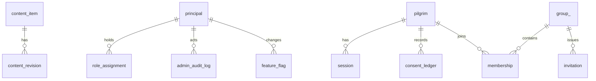

# Database design (enterprise draft)

Status: **PROPOSED, not approved. No migration exists and nothing is applied to any database.** Prepared 2026-11-15. The SQL is in [database-schema-draft.sql](database-schema-draft.sql), kept outside `migrations/` on purpose: the checks in [DATA_MODEL_PROPOSAL.md](DATA_MODEL_PROPOSAL.md) ("Checks before any migration is written") are not met. This design follows the data model proposal, the [RBAC matrix](RBAC_MATRIX.md) and [ADR 0012](../decisions/0012-backend-architecture-and-d1.md). Legal and residency conclusions stay with counsel (OQ-024, OQ-026, OQ-027).

## Principles

1. **One database per environment** (preview, staging, production), created by an owner.
2. **Opaque random ids**, UTC times set by the server, `STRICT` tables, `CHECK` constraints for every enum.
3. **Rules live in the schema where possible**: four-eyes approval, no self-granted roles, append-only audit and consent, every role assignment has an end date.
4. **Never stored:** coordinates or location history, card data, OTPs, secrets, child or missing-person records, phone numbers, emails.
5. **All access through one repository module** with parameterised statements. Ownership comes from the session, never from a client-supplied id.
6. **Forward-only migrations**, expand then contract.

## Entity overview

## Tables by tier

| Tier                  | Table                    | Purpose                                                                        | Class |
| --------------------- | ------------------------ | ------------------------------------------------------------------------------ | ----- |
| 1 Public content      | `content_item`           | One row per kind, locale and slug; points to the current and published version | P     |
|                       | `content_revision`       | Every version, with source, status and four-eyes review                        | P/I   |
| 2 Staff and RBAC      | `principal`              | Staff identity mapped from Access (issuer + subject)                           | S     |
|                       | `role_assignment`        | Role, scope, granter, expiry, revocation                                       | S     |
|                       | `admin_audit_log`        | Append-only record of staff actions                                            | S     |
|                       | `feature_flag`           | Kill switches; absent or 0 means off                                           | I     |
| 3 Pilgrim records     | `pilgrim`                | Minimal subject record (hashed subject only)                                   | U     |
|                       | `session`                | Hashed session token, idle and absolute expiry, revocation                     | U     |
|                       | `consent_ledger`         | Append-only grant and withdrawal by purpose and notice version                 | U     |
|                       | `group_`, `membership`   | Group metadata and who belongs (no positions)                                  | U     |
|                       | `invitation`             | Hashed, expiring, revocable join codes                                         | U     |
| 4 Operational / legal | `partner_inquiry`        | Partner and shop onboarding requests                                           | U/S   |
|                       | `legal_request_register` | Authority requests (nodal officer only)                                        | S     |
|                       | `legal_hold`             | Suspends deletion for named records                                            | S     |
|                       | `retention_run`          | Proof that deletion and expiry jobs ran                                        | I     |

Classes: **P** public, **I** internal, **S** staff personal data, **U** user personal data. The group table is named `group_` because `group` is a reserved SQL word.

## How the schema enforces the RBAC rules

| RBAC rule                                  | Enforced by                                                                     |
| ------------------------------------------ | ------------------------------------------------------------------------------- |
| Author cannot approve their own content    | `CHECK (reviewer_ref <> author_ref)` on `content_revision`                      |
| Approved needs a reviewer and date         | `CHECK` on `content_revision.status`                                            |
| Nobody grants themselves a role            | `CHECK (granted_by_ref <> principal_id)` on `role_assignment`                   |
| Every role has an end date, can be revoked | `expires_on NOT NULL`, `revoked_on`                                             |
| Audit log cannot be edited or deleted      | `BEFORE UPDATE` and `BEFORE DELETE` triggers abort                              |
| Consent history cannot be rewritten        | `BEFORE UPDATE` trigger on `consent_ledger`                                     |
| Only approved content is served            | Public reads use `published_revision_id` only; partial index on published items |
| Risky features fail closed                 | `feature_flag.enabled` defaults to 0; names limited by `CHECK`                  |

Triggers stop the application, but a D1 restore can still replace rows. See the restore rules below.

## Retention and restore rules

| Data                   | Rule (proposal, retention decision BF-08 not made)                | After a D1 restore                                                 |
| ---------------------- | ----------------------------------------------------------------- | ------------------------------------------------------------------ |
| Sessions               | Deleted at expiry                                                 | Expired rows are invalid by time                                   |
| Groups and invitations | Expire with the event window                                      | Run the expiry job; check expiry at use                            |
| Consent, pilgrim rows  | Per retention decision; erasure on request                        | Replay the erasure and withdrawal list                             |
| Removed staff, roles   | Kept for the audit period                                         | Re-run revocation from a list kept outside D1 so nobody is revived |
| Audit log              | Period set by BF-06 and BF-08; CERT-In period unverified (OQ-007) | Ship a copy to an India-resident sink (OQ-017)                     |
| Partner inquiries      | Closed ones deleted after a set period                            | Replay deletions                                                   |

`retention_run` records every job so deletion can be evidenced.

## Not in this draft

- **`pass_record`:** no field list until the Pass contract and notice exist.
- **`payment_reference`, `webhook_event`:** blocked on the payments and donations review.
- **Location, missing-person and child records:** never in a table (ADR 0004, ADR 0006).

## Before this becomes a migration

1. The BF decisions are recorded with named reviewers and a repository revision.
2. Counsel answers residency and retention for each tier. D1 has no India location option.
3. Every personal field has a data-inventory row and a notice.
4. Tests prove erasure, withdrawal, expiry and post-restore reconciliation with synthetic rows.
5. An owner creates the separate per-environment databases.

## Evidence

The draft SQL was loaded into an in-memory SQLite database (Node 22 `node:sqlite`). 16 tables were created. Self-approval, approval without a reviewer, self role grant, audit update and delete, an unknown flag name and an orphan membership were each rejected. This is a syntax and constraint check only: it was not run on D1, and no migration test, restore test or CI check covers it yet.
