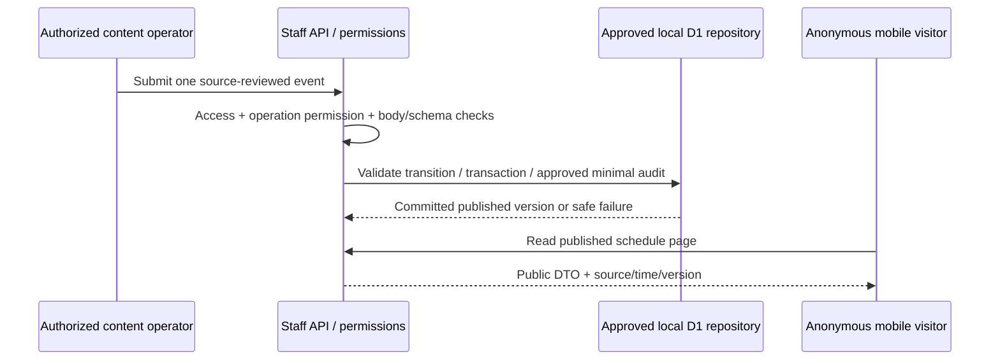

# Pushkara Mitra — original mobile product blueprint

**Status:** proposed product/workflow architecture for review, not delivered functionality or legal/launch approval. Prepared 2026-11-04 (IST). User direction: use Kumbh-Sathi only as a functional benchmark; **zero copying of its code, images, icons, colors, text or branded presentation**. Build an original mobile experience for Godavari Pushkaralu 2027.

The [benchmark inventory](REFERENCE_PARITY_ACCEPTANCE.md) preserves the observed functional coverage and unknowns. It is not a visual template, implementation specification or permission to reuse materials. This blueprint supersedes any earlier implication that exact visual replication is the target. [Architecture](../architecture.md) defines the recommended code/security boundaries; [readiness audit](../DELIVERY_READINESS.md) shows what actually exists.

## Product model and actors

Recommend an installable mobile-first PWA as the first delivery surface, consistent with the current project architecture. Android/iOS packaging and store distribution are separate decisions with signing, deep-link/auth, permissions, update and device-testing obligations. A wrapper is not evidence of background location or push capability; neither is promised by this blueprint.

Actors are proposed permission domains, not pre-created roles or approved authority:

- **Visitor:** public reviewed information, safe offline material and preferences without an account.
- **Pilgrim:** verified identity for approved owned registration, cards, private status/inbox and group actions. Proposed Google OIDC is server-verified; browser identity claims alone are insufficient.
- **Content operator:** publish only reviewed public content through explicit permissions.
- **Safety moderator:** restricted report triage/contact release under approved procedures; not automatically every staff member.
- **Operations/security owner:** incident/revocation and configuration responsibilities; no self-assigned administration.
- **Human approvers/counsel:** actually record applicable scope/security/privacy/legal/production decisions; cannot be substituted by agent review or a green build.

Staff use separate Access verification and per-operation authorization. Exact assignment, retention, session lifetimes, purpose notices and real-world operators remain recorded decisions before processing. Public browsing must not be held hostage to sign-in or unavailable providers.

## Original information architecture and complete coverage

Names are working organization labels, not trademark clearance or implemented screens. Content and visual identity are independently authored; do not sample the benchmark's palette or trace its assets/layout. Use an original design system with semantic tokens, accessible contrast, readable Telugu typography and a distinct navigation/component language. Final visual work requires original mobile/desktop artifacts and browser evidence, not descriptions alone.

| Original area          | User journey and acceptance outcome                                                                                                                                                                                                                                                                          | Benchmark acceptance coverage                                       | Data / prerequisites                                                                                                                                                                           |
| ---------------------- | ------------------------------------------------------------------------------------------------------------------------------------------------------------------------------------------------------------------------------------------------------------------------------------------------------------ | ------------------------------------------------------------------- | ---------------------------------------------------------------------------------------------------------------------------------------------------------------------------------------------- |
| **My Pushkaram**       | Open the app → see reviewed current information and honest freshness → use shortcuts → change language/theme → open owned profile/status when signed in. Countdown appears only from verified configurable event dates.                                                                                      | FP-01–04, FP-06, FP-16, FP-23, FP-25–26                             | Public dashboard; private profile/inbox separately authorized. Original branding/legal notices and reviewed source data.                                                                       |
| **Plan Your Visit**    | Browse/filter schedule → inspect a ghat/public facility → choose directions → compare reviewed stays/transport/cultural information → understand provenance, estimated crowd conditions and stale/unavailable states.                                                                                        | FP-05, FP-07–10, FP-15, FP-20                                       | Public published DTOs; maps/provider configuration, verified Godavari sources, reviewed public geospatial classification. Device-location processing separately consented and never persisted. |
| **Pilgrim Pass**       | Sign in → understand notice → submit approved minimal fields → receive a server-confirmed owned record → show/download a restricted-disclosure, non-authentication QR/card → amend/delete under reviewed lifecycle. Failed remote save is not “registered.”                                                  | FP-04, FP-18–19                                                     | Identity/ownership/retention and QR-disclosure contracts. Do not introduce child, medical, contact/photo or dependent data merely to resemble a reference form.                                |
| **Travel Together**    | Create/join a bounded group → accept invitation/membership → explicitly opt into sharing → see freshness/availability → withdraw/leave → send a bounded group SOS and see truthful delivery/member-acknowledgement status; claim responder dispatch only under a separately approved real operator protocol. | FP-21–22                                                            | G1/G2 threat/abuse/consent review. Memory-only positions, expiry/replay tests, bounded group/connection rates; no recovery via stored coordinates.                                             |
| **Help & Reunite**     | Find verified emergency/first-aid contacts → submit an approved report → private triage/moderation → controlled contact access → correction/resolution/expiry. Show limits of the service; do not imply official rescue dispatch.                                                                            | FP-11–13                                                            | Qualified safety/moderation owners, G1/G2, redacted server DTOs, real contact verification, abuse/media/retention procedures. Children/missing-person exposure never public by default.        |
| **Festival Updates**   | Read source-reviewed announcements/categories/advisories → see source/time → receive permitted status messages → ask bounded contextual questions with honest uncertain/unavailable responses.                                                                                                               | FP-14, FP-20, FP-23–24                                              | Reviewed publishing, provenance and assistance providers/budget policy; no heuristic “live” truth or guaranteed AI emergency advice.                                                           |
| **Community Partners** | Browse clearly disclosed approved listings → inspect source/contact/privacy/disclosure → send an inquiry → see acknowledged status. Sponsor inquiry does not imply checkout, payment or analytics delivery.                                                                                                  | FP-09, FP-17                                                        | G2 directory/contact review where applicable; original assets and disclosure; payment/donation capabilities require separately defined G3/provider scope if added.                             |
| **Staff Console**      | Verify Access identity → receive only assigned operations → draft/review/publish content or moderate authorized records → see minimal audit outcomes → revoke access through human-owned process.                                                                                                            | Original operational layer supporting all published/protected flows | G1 permissions, audit/retention and operational failure contracts; staff UI is not the enforcement boundary.                                                                                   |

Cross-cutting requirements preserve all 26 benchmark acceptance items: original responsive navigation, light/dark themes, reviewed Telugu-default English/Hindi/Marathi catalogs, safe install/offline/share/update behavior, keyboard/screen-reader/zoom/reduced-motion support, loading/empty/error/retry states and honest provider failures. No row is considered complete from a static mock or a health check.

## Workflow contracts

### Public content: first useful end-to-end slice

Required acceptance: unauthorized staff cannot mutate; unpublished records never enter public DTOs; invalid/oversized inputs rejected; parameterized SQL; actual assets and APIs traverse correct middleware; mobile Telugu-first page has loading/empty/error and accessible controls. First use synthetic fixture content/local D1 until approved real sources/contracts are supplied. Public event dates are configuration, not invented constants.

### Protected actions

Every protected action declares principal, operation/resource permission, subject ownership, approved input/response fields, durable/ephemeral classification, consent/purpose basis where applicable, failure behavior, idempotency and retention. Lists and indirect object/media references enforce the same boundary as single-record reads. Stable errors distinguish rejected, unavailable, local-only and server-confirmed states without exposing internal data.

For consent: explicit approved purpose/notice version → affirmative action → authorized atomic record and enforcement → accessible withdrawal → later processing stops under the reviewed contract. Browser permission is not consent; replayed/offline historical grants cannot resurrect a later withdrawal. No generic personal-data write queue.

For sensitive reports/media: permission and safety decisions → private quarantine/review → redacted views and controlled release → resolution/expiry/deletion. No scanning/moderation stub may masquerade as an operational safeguard.

## Delivery workflow and accountability

1. **Scoped issue:** actor journey, exact acceptance, data classification, source/provenance, operational owner, applicable gates and dependency contracts.
2. **Contract/design:** original mobile layouts, input/output/errors, authorization/resource policy, state transitions, cache/retention rules and negative test plan. No reference asset/code transplant.
3. **Independent implementation PRs:** frontend and backend agents share validated DTOs, use separate branches, synthetic fixtures and truthful integration states. No direct main write or self-approval.
4. **Independent verification:** tests actually execute the intended paths, including real Wrangler assets/local services, browser/mobile/offline/accessibility, privacy/security negatives and failure recovery. Report exact commit and outcomes.
5. **Human review and integration:** applicable independent approvals are recorded against reviewed content/head; humans merge. Existing staging automation and functional verification are distinct from production authorization.
6. **Status:** prepend a timestamped IST entry with implementer, accountable human owner, actual independent reviewer state, PR/issue, exact checks, blocker and next owner. Preserve older entries below it.
7. **Release:** engineering readiness, legal/safety decisions and production launch are separately recorded. Keep production blocked until explicitly authorized; no agent deploys it.

## Build order without reducing the target

1. Routing/header boundary and real asset tests; review current stabilization PRs.
2. Original shell/navigation/design tokens/language infrastructure, manifest/icons/registration and safe public offline fallback; approve frontend build/boundary contract.
3. In parallel, finalize G0/G1 contracts and implement verified staff/pilgrim identity, sessions, permissions and minimal approved D1 structures.
4. Deliver the public event publishing → anonymous schedule slice, then reviewed public map/stay/transport/news/cultural data and honest weather/crowd integration.
5. Add owned pass/QR and private inbox with server acknowledgement, minimal disclosure and lifecycle tests.
6. Add approved moderation/contact/media/report and ephemeral group/SOS flows only when real safeguards/operators and gates exist; keep them visible in backlog, never silently substitute a mock.
7. Complete partner inquiry and bounded assistance, all cross-cutting behaviors, feature integration and mobile packaging decision.
8. Full staging UAT, load/abuse/degraded-network, restore/revocation/withdrawal drills, accessibility/native-language review and release/operations evidence.

No defensible final-delivery date or completion percentage follows from scaffold CI. Estimate after acceptance scope, provider/data/operator availability, approvals and measured implementation throughput are known. The next step is an explicitly reviewed small slice, not declaring the full app ready or starting every high-risk feature at once.
