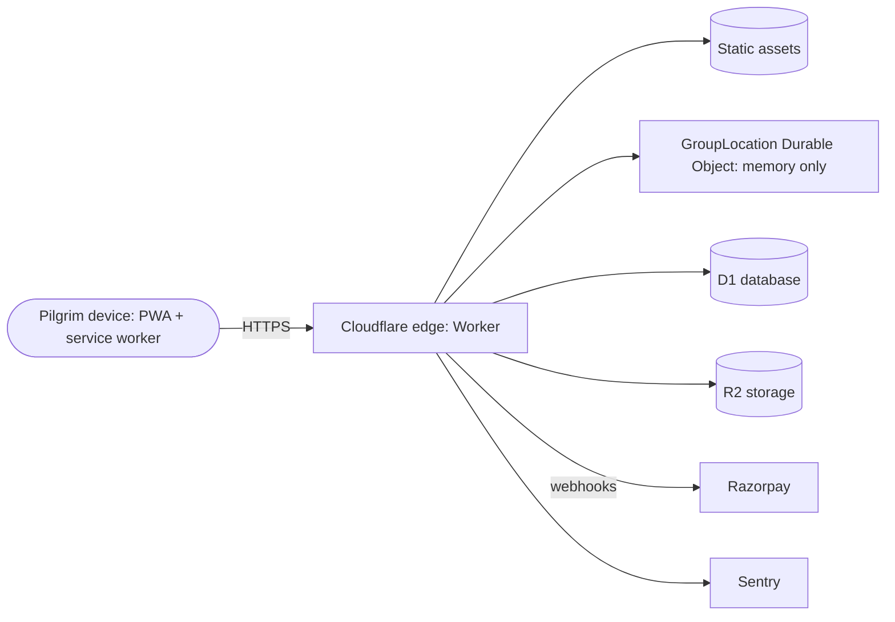

# Threat model v1 (draft)

Method: STRIDE per component, plus abuse cases. Status: `NEEDS REVIEW`. Update this file whenever a trust boundary changes (PR checklist item).

## Components and trust boundaries

Boundaries: device to edge (untrusted client), edge to third parties (processors), and CI to Cloudflare (deploy credentials).

## STRIDE per component

| Component              | Spoofing                        | Tampering                       | Repudiation                               | Information disclosure                                    | Denial of service             | Elevation of privilege       |
| ---------------------- | ------------------------------- | ------------------------------- | ----------------------------------------- | --------------------------------------------------------- | ----------------------------- | ---------------------------- |
| PWA and service worker | Fake official clone of the app  | Cache poisoning of shell        | n/a                                       | Personal data in cache or storage                         | Large cache exhaustion        | XSS via injected content     |
| Worker (edge)          | Forged requests or tokens       | Parameter tampering             | Missing audit trail for sensitive actions | Verbose errors, headers leaking info                      | Request floods at event scale | Missing authorisation checks |
| GroupLocation DO       | Joining a group as someone else | Spoofed position updates        | Disputed sharing                          | Leaking locations to non-members, persistence of location | Connection floods             | Cross-group access           |
| D1 and R2              | Stolen credentials              | SQL injection, object overwrite | Untracked admin changes                   | Over-collection, public buckets                           | Query abuse                   | Over-broad bindings          |
| Payments (Razorpay)    | Fake webhook                    | Amount tampering                | Disputed payments                         | Card data exposure (must never touch us)                  | Webhook replay storms         | Refund abuse                 |
| CI/CD                  | Malicious PR or action          | Workflow injection, tag move    | Unsigned commits                          | Secret exfiltration                                       | Runner abuse                  | Token over-permission        |

Mitigations that exist today: strict CSP and security headers (tested), pinned third-party actions, least-privilege workflow permissions, secret scanning, no `pull_request_target`, and a location-persistence guard test. All others are planned.

## Abuse cases

| ID    | Abuse case                                         | Primary mitigations (planned unless noted)                                               |
| ----- | -------------------------------------------------- | ---------------------------------------------------------------------------------------- |
| AB-01 | Stalking or coercion through location sharing      | Opt-in per session, visible indicator, instant stop, auto-expiry, no history (ADR 0004)  |
| AB-02 | Coercion to share location within a family         | Per-person controls, quiet-exit design, no hidden mode                                   |
| AB-03 | Compromised account used to track others           | Re-authentication for sharing, session limits, anomaly alerts                            |
| AB-04 | Fake official groups or fake "government" accounts | Never look official, government disclaimer, verified-organiser path decided with counsel |
| AB-05 | Vendor fraud (fake or look-alike vendors)          | Vendor verification, report button, takedown path                                        |
| AB-06 | Missing-person impersonation or false report       | Verification with authorities, rate limits, review                                       |
| AB-07 | Payment phishing using our brand                   | Fixed payment domains, no payment links in messages, user education                      |
| AB-08 | Directory scraping                                 | Rate limits, bot controls, no bulk export                                                |
| AB-09 | Supply-chain attack on dependencies or actions     | SHA-pinned actions, lockfile, licence and vulnerability checks, SBOM                     |

## Open items

Risk ratings and the review sign-off are pending (M0 exit criterion: "threat model v1").

## Sole-owner preview bootstrap boundary (2026-11-14)

The preview bootstrap workflow can create a missing preview Worker and its initial SQLite-backed Durable Object namespace using a Cloudflare credential. Because `gkmraju` is the sole maintainer, the previous independent PR approval cannot be obtained. The owner-dispatched workflow instead checks the actor, manual confirmation, a recorded human preflight, a merged PR matching the immutable current `main` SHA, and local checks before the credential-bearing deployment step. GitHub's preview environment permits only `main`; the credential is scoped to the final preview step. The owner must inspect the Cloudflare account, Worker and namespace state and establish a single-writer window before dispatch.

Residual risk: the preflight is an owner attestation, not a platform verification of account state or an atomic create-if-absent operation. A compromised owner account or concurrent out-of-band Cloudflare action could still cause an unsafe bootstrap. If the account, namespace or single-writer window is uncertain, stop; do not run or retry the workflow. This preview exception does not authorize production deployment, location persistence or public activation.

## Original public prototype candidate — review boundary

This unmerged candidate adds only original public static pages and a six-resource offline allow-list. The canonical root and those assets must remain unconditional public representations; no authenticated or personalized response may be served at these paths. API/admin/auth, query-bearing, cross-origin, non-GET and Authorization-bearing requests are outside the service-worker cache. The redirected index.html alias is not precached or promised offline.

Readiness requires the current controlling worker to acknowledge the expected cache revision and complete static set. Failed new installation with an older active worker must never report the new revision ready. Old in-flight workers can finish public requests; perpetual disappearance of every legacy public cache is not a security guarantee. Cache/protocol/helper versions must change together when static content changes.

Same-origin script or service-worker compromise remains a trust risk; CSP, safe text rendering, exact static source review and deployment credential isolation are required defenses, not proof against all attacks. No identity, D1, consent, location or private processing is activated here. Future authenticated routes must reassess static paths, logout/session boundaries and cache behavior before release. Hosting connection-data handling remains unverified and requires privacy review. Native-language, accessibility, legal/IP and independent human approval remain pending.
